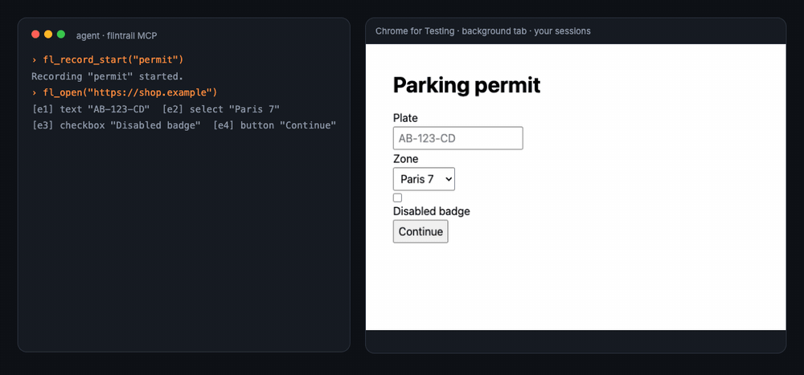
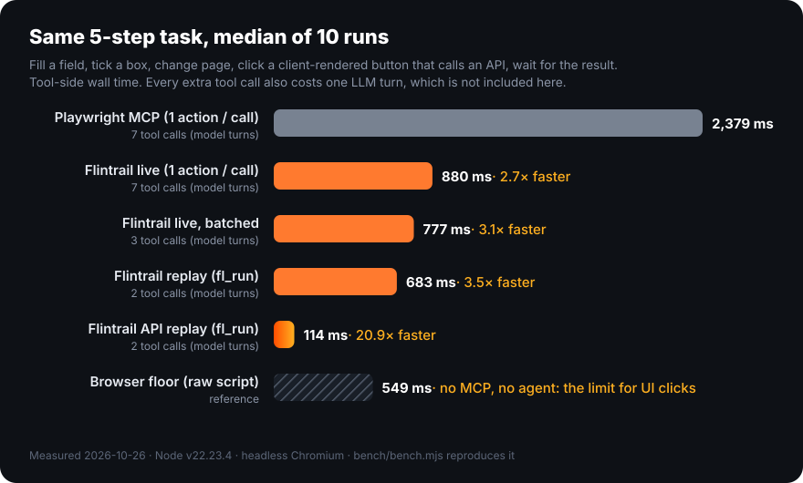
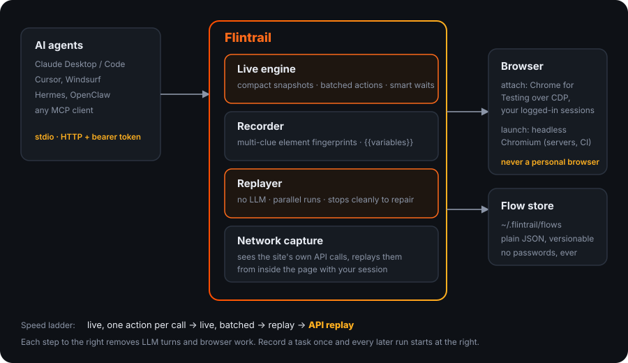
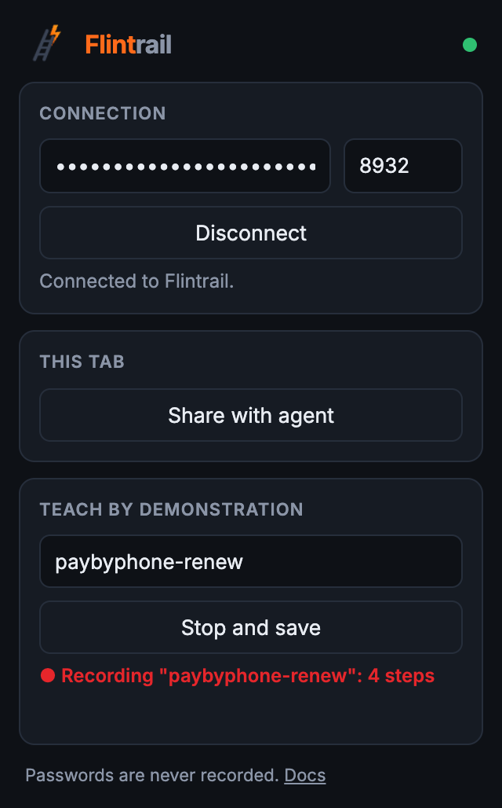

<p align="center">
  
</p>

<h3 align="center">The fastest browser for AI agents.</h3>

<p align="center">
  Drive a real Chrome live. Record a task once. Replay it in milliseconds, with no LLM in the loop.<br>
  Or skip the page entirely and replay the site's own API calls with your session.
</p>

<p align="center">
  <a href="https://github.com/Soflutionltd/flintrail/actions/workflows/ci.yml"></a>
  
  
  
  
</p>

<p align="center">
  
</p>

---

## Why

Browser MCP servers today make the model do everything, every time: read the page, pick one element, click, read the page again. Each click is a tool call, and each tool call is a model turn that costs seconds. Do the same task tomorrow and the agent pays the full price again.

Flintrail treats the browser like a JIT compiler treats code:

1. **Live**, the agent drives the page, but batches a whole sequence of actions into one call and gets back a compact snapshot with clickable refs.
2. **Record**, the same calls are captured with multi-clue element fingerprints and `{{variables}}`.
3. **Replay**, the flow runs at browser speed with no model between steps. When a site changes, the run stops at the exact failing step and hands the page back so the agent repairs only that part.
4. **API replay**, Flintrail sees the site's own fetch/XHR calls and can replay them from inside the page, with the same cookies and session. No rendering, no clicking.

## Benchmark

<p align="center"></p>

Same 5-step task (fill a field, tick a box, change page, click a client-rendered button that calls an API, wait for the result), median of 10 runs, headless Chromium. The numbers are tool-side wall time only. In a real agent every tool call also costs a model turn, so going from 7 calls to 2 saves several more seconds on top.

The hatched bar is the floor: the same clicks as a raw Playwright script, with no MCP and no agent. Any tool that clicks through the UI is bounded by it, which is why the per-call ratios stay modest. Flintrail adds about 50 ms per call on top of that floor, Playwright MCP about 260 ms. The only way under the floor is to stop clicking, which is what API replay does.

Reproduce it: `npm run bench` (installs nothing global; Playwright MCP is a dependency of `bench/` only).

## Architecture

<p align="center"></p>

## Install

**Claude Desktop:** download [`flintrail.mcpb`](https://github.com/Soflutionltd/flintrail/releases/latest/download/flintrail.mcpb) and double-click it.

### Claude Desktop, Claude Code, Cursor (stdio)

```json
{
  "mcpServers": {
    "flintrail": {
      "command": "npx",
      "args": ["-y", "flintrail@latest"]
    }
  }
}
```

Claude Code: `claude mcp add flintrail -- npx -y flintrail@latest`

From a local clone (`git clone https://github.com/Soflutionltd/flintrail.git && cd flintrail && npm install && npm run build`), start `node /absolute/path/to/flintrail/bin/supervise.cjs`.

### Automatic updates

Every install below keeps itself up to date, without restarting Claude or Cursor. The MCP client talks to a small supervisor (`bin/supervise.cjs`) that stays connected while the server runs behind it. At start-up and every 6 hours it asks npm for the latest `flintrail`, installs it in the background in `~/.soflution/mcp/flintrail/`, and switches over as soon as no request is in flight (the client is told the tool list may have changed). A version that fails to start is rolled back at once and never picked again on that machine. npm checks the integrity of every download, and releases are published from GitHub Actions with provenance.

The only network call is that version check to `registry.npmjs.org`; nothing about your machine or your use is sent. Turn it off with `NO_UPDATE_NOTIFIER=1` (or `SOFLUTION_AUTO_UPDATE=0`). Started directly with `node dist/...`, flintrail does not update itself and only mentions a newer version in its first tool result.

### Any agent, any machine (HTTP)

```bash
node dist/cli.js --http --host 127.0.0.1 --port 8931
# token is generated once in ~/.flintrail/token (or pass --token / FLINTRAIL_TOKEN)
```

Clients connect to `http://host:8931/mcp` with `Authorization: Bearer <token>`. Put it behind a tunnel or reverse proxy with TLS if it leaves the machine.

## Browser modes

| Mode | When | How |
|---|---|---|
| `attach` (default) | Your desktop. Keep your logged-in sessions. | Connects over CDP to a dedicated **Chrome for Testing**. On macOS Flintrail finds it, restarts it with a local debugging port if needed (tabs are restored) and opens its own tabs in the background. |
| `launch` | Servers, CI, Docker. | `FLINTRAIL_MODE=launch` starts Chromium with a persistent profile in `~/.flintrail/profile`, headless by default. |
| `extension` | Anyone, any Chromium browser, no debugging port. | `FLINTRAIL_MODE=extension` and the Flintrail extension installed. See below. |

Flintrail refuses to attach to a personal browser (Brave, Edge, Opera, or on macOS anything that is not Chrome for Testing) unless `FLINTRAIL_ALLOW_ANY_BROWSER=1`. Your everyday browser stays yours.

## Browser extension

The extension is the easiest way in: no command-line flags, no debugging port, works in Chrome, Edge, Brave, Arc or any Chromium 125+.

<p align="center"></p>

1. **Install.** Download `flintrail-extension-<version>.zip` from the [latest release](https://github.com/Soflutionltd/flintrail/releases/latest), unzip it, open `chrome://extensions`, enable *Developer mode*, click *Load unpacked* and pick the folder. (Chrome Web Store listing in progress.)
2. **Run Flintrail in extension mode**, for example in Claude Desktop:
   ```json
   { "mcpServers": { "flintrail": { "command": "npx", "args": ["-y", "flintrail@latest"], "env": { "FLINTRAIL_MODE": "extension" } } } }
   ```
3. **Connect.** Click the Flintrail icon, paste the token from `~/.flintrail/token`, click *Connect*. The extension reconnects by itself afterwards.

How it works: Flintrail starts a relay on `127.0.0.1:8932`. The extension connects to it with the token and executes CDP commands with `chrome.debugger`, one tab at a time. Playwright sees an ordinary CDP browser, so every tool, recording and replay works unchanged. The agent only sees tabs it opened itself or tabs you share with *Share with agent*. Chrome shows its "started debugging this browser" bar while a tab is driven, by design.

### Teach by demonstration

You do not have to explain a task to the agent. Type a flow name in the popup, click *Start recording*, do the task yourself in the tab, click *Stop and save*. The extension records clicks, typing, selects, checkboxes and Enter with the same element fingerprints the engine uses, and never records password fields. Then:

```text
fl_flow_set_var("paybyphone-renew", 0, "plate")   # turn the typed plate into {{plate}}
fl_run("paybyphone-renew", { "plate": "AB-123-CD" })
```

The flow now runs without you, without the LLM, in milliseconds per step.

Limits in extension mode: browser-level CDP (download folder, permissions, window size) is not available to extensions, so `download` saves through the browser's normal download flow. Chrome dismisses dialogs of background tabs driven by `chrome.debugger` before anyone can answer, so in this mode `{do:"dialog"}` answers the next `alert` / `confirm` / `prompt` from inside the page instead.

## Tools

| Tool | What it does |
|---|---|
| `fl_open` | Open a URL in a background tab, return a compact snapshot with `[eN]` refs. |
| `fl_act` | Run many actions in one call: `click`, `dblclick`, `hover`, `fill`, `type`, `select`, `check`, `press`, `upload`, `download`, `goto`, `back`, `wait`, `scroll`, `mouse`, `dialog`, `resize`, `eval`, `request`. |
| `fl_snapshot` | Re-read a page: interactive elements, headings, text excerpt, same-origin frames. |
| `fl_extract` | Run JavaScript in the page and return the result. |
| `fl_network` | List the site's own API calls with timing, body and a JSON sample. |
| `fl_screenshot` | JPEG screenshot of the tab, or of one element (`ref` / `selector`), in CSS pixels usable by `mouse`. |
| `fl_console` | Console errors and uncaught exceptions of a tab (`level: "all"` adds warnings and logs). `fl_act` says when new ones appear. |
| `fl_record_start` / `fl_record_stop` | Record a flow; `repairFrom` keeps the good steps and re-records the rest. |
| `fl_run` | Replay a flow with variables, no LLM. |
| `fl_run_many` | Replay a flow for many variable sets in parallel tabs. |
| `fl_flows` / `fl_flow` | List flows, inspect one. |
| `fl_flow_set_var` | Turn a recorded value into a `{{variable}}`, for flows taught by demonstration. |
| `fl_extension` | Extension connection status. |
| `fl_adopt` | Take control of a tab you already opened yourself, for example right after signing in by hand. |
| `fl_login` | Sign in with your saved password (browser password manager, 1Password, Bitwarden or your own command). Flintrail fills it, the agent never sees it. See [Sign in](#sign-in). |
| `fl_tabs` / `fl_close` | Manage tabs. |

### Example

```jsonc
// one call, five actions
{ "tool": "fl_act", "tab": "t1", "actions": [
  { "do": "fill",  "ref": "e1", "value": "AA-111-AA", "var": "plate" },
  { "do": "check", "ref": "e3" },
  { "do": "click", "role": "button", "name": "Continue" },
  { "do": "click", "selector": "[data-testid=confirm]" },
  { "do": "wait",  "text": "active" }
]}
```

Then `fl_run("permit", { "plate": "ZZ-999-ZZ" })` repeats it in under a second.

```jsonc
// files, native dialogs, coordinates, mobile width
{ "tool": "fl_act", "tab": "t1", "actions": [
  { "do": "upload", "ref": "e4", "files": ["/Users/me/statement.csv"], "var": "statement" },
  { "do": "dialog", "accept": true },
  { "do": "click", "role": "button", "name": "Delete" },
  { "do": "mouse", "x": 640, "y": 380 },
  { "do": "resize", "width": 390, "height": 844 }
]}
```

`upload` works on a file input, even a hidden one, and on a button or drop zone that opens the file chooser. Dialogs are dismissed by default and every one is reported in the result, as are new console errors.

## Sign in

`fl_login` signs the agent in with the passwords you already have, without ever showing them to the agent: it only learns which fields were filled. Passwords and one-time codes are masked in every tool result, including captured request bodies and page reads, and a recorded flow stores a reference to the login, never the secret. On a multi-step sign-in (e-mail page, then password page) the agent calls it on each step.

Sources are tried in the order of `FLINTRAIL_PASSWORDS` (default `browser`):

| Source | Setup | Notes |
|---|---|---|
| `browser` | None. Save the password in Chrome, Edge or Brave as usual. | The browser fills the form itself; Flintrail confirms with a real click and submits. Works in extension mode and in attach mode, on the profile that holds your passwords. With several saved accounts for a site, the browser picks one: use a CLI source to choose. |
| `1password[:path]` | [1Password CLI](https://developer.1password.com/docs/cli/) signed in, or `OP_SERVICE_ACCOUNT_TOKEN` in Flintrail's environment for unattended use. | One-time codes stored in 1Password are filled too. A service account never asks for Touch ID; scope it to a vault that holds only what the agent needs. |
| `bitwarden[:path]` | [Bitwarden CLI](https://bitwarden.com/help/cli/) unlocked, `BW_SESSION` in Flintrail's environment. | One-time codes through `bw get totp`. |
| `command:path` | Any program: Flintrail runs it with the page URL as only argument. | It prints `[{ "url", "username", "password", "totp"?, "title"? }]`. Use it for KeePassXC, Dashlane, `pass` or a company vault. |

Logins from a CLI source are only filled in frames whose domain matches the login's website, so a look-alike page gets nothing. Several matches: the agent passes `item` (ID, title or username). Example for Claude Desktop:

```json
"env": { "FLINTRAIL_PASSWORDS": "browser,1password" }
```

Not supported: Apple Passwords (iCloud Keychain) has no command-line access. One-time codes sent by SMS, e-mail or phone prompt: `fl_login` says so and the agent asks you.

## How replay finds elements again

Each recorded step stores a fingerprint, not a fragile selector: test id, stable id, `name` attribute, ARIA role and accessible name, placeholder, link target, visible text and a short CSS path. At replay time Flintrail tries them from most to least stable and takes the first that matches exactly one element, waiting only for that element, never for the network to go idle.

## Security

- No password is ever written to a flow. Password fields are skipped during recording; keep the session logged in instead.
- `fl_login` never returns a password or a one-time code to the agent and masks them in every tool result. CLI logins are only filled on their own website. Password manager programs are chosen in the configuration, never by the agent, and run without a shell.
- Flows are plain JSON in `~/.flintrail/flows`, easy to review and version.
- The HTTP transport requires a bearer token (constant-time comparison) and binds to `127.0.0.1` by default.
- `eval` and `request` run inside the page with the page's own privileges, nothing more.

## Configuration

| Variable | Default | |
|---|---|---|
| `FLINTRAIL_MODE` | `attach` | `attach`, `launch` or `extension` |
| `FLINTRAIL_RELAY_PORT` | `8932` | Local port the extension connects to |
| `FLINTRAIL_CDP_URL` | `http://127.0.0.1:9222` | Browser to attach to |
| `FLINTRAIL_PORT` | `9222` | Debugging port used when Flintrail starts Chrome for Testing |
| `FLINTRAIL_CHROME` | auto | Browser executable |
| `FLINTRAIL_HEADLESS` | `1` | `0` to see the window in launch mode |
| `FLINTRAIL_HOME` | `~/.flintrail` | Flows, profile, token |
| `FLINTRAIL_DOWNLOADS` | `~/Downloads/Flintrail` | Where downloads land |
| `FLINTRAIL_TOKEN` | generated | HTTP bearer token and extension token |
| `FLINTRAIL_PASSWORDS` | `browser` | Password sources for `fl_login`, in order: `browser`, `1password[:path]`, `bitwarden[:path]`, `command:path`. `off` removes the tool. |

## Develop

```bash
npm install
npx playwright-core install chromium   # once, for tests
npm test                               # build + 26 end-to-end tests over real MCP, extension included
npm run pack:extension                 # flintrail-extension-<version>.zip
npm run bench                          # benchmark vs Playwright MCP
```

## Roadmap

- Chrome Web Store and Edge Add-ons listings for the extension.
- Automatic promotion of recorded UI steps to API steps when the captured call is replay-safe.
- Shared flow library for common sites.
- Visual diff on replay failure.

## En français

Flintrail est un serveur MCP de navigation pour agents IA. Il pilote un vrai Chrome dédié (jamais votre navigateur personnel), enchaîne plusieurs actions en un seul appel, enregistre une tâche la première fois puis la rejoue seul, sans IA, en quelques centaines de millisecondes, ou en rejouant directement les appels API du site avec votre session. Sur notre banc d'essai, la même tâche prend 2,4 s avec Playwright MCP et 0,11 s avec Flintrail en mode API.

L'extension Chrome rend tout cela accessible à tout le monde : on l'installe, on colle le jeton, et l'agent pilote le navigateur. Mieux, on peut lui apprendre une tâche en la faisant soi-même une fois (bouton *Start recording*), Flintrail la rejoue ensuite seul. Les mots de passe ne sont jamais enregistrés.

Pour se connecter, l'agent utilise `fl_login` avec vos mots de passe habituels : ceux enregistrés dans le navigateur (sans réglage), ou 1Password, Bitwarden ou tout autre gestionnaire par sa ligne de commande. Flintrail remplit le formulaire lui-même, l'agent ne voit jamais ni le mot de passe ni le code.

## License

MIT © 2026 Soflution Ltd
