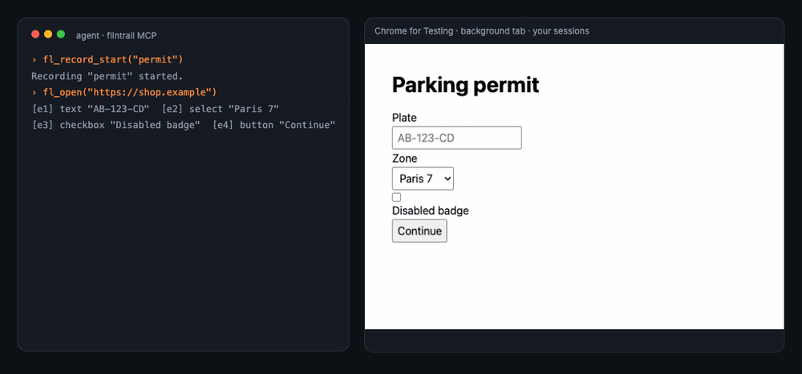
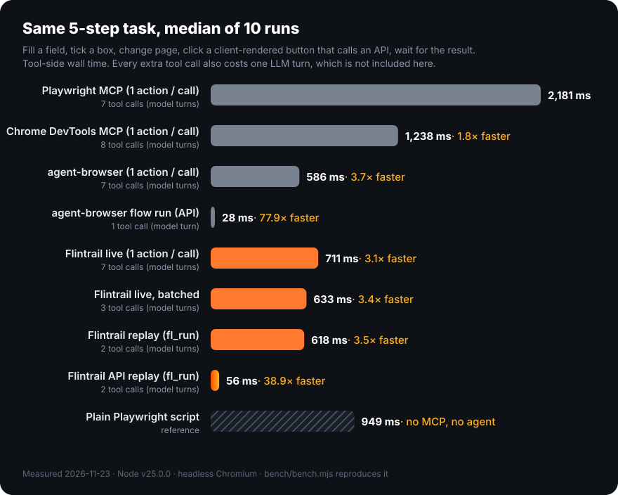
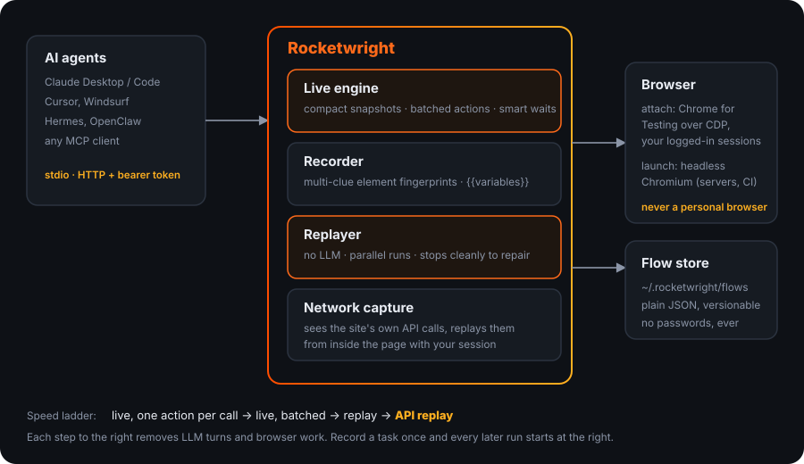
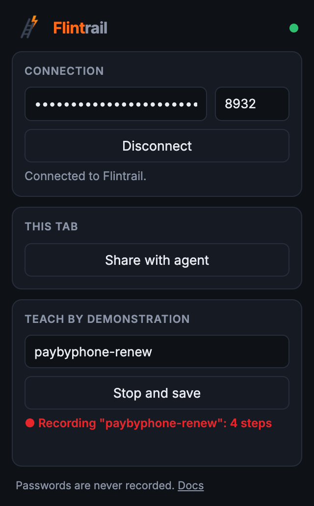

<p align="center">
  
</p>

<h3 align="center">The fastest browser for AI agents.</h3>

<p align="center">
  Drive a real Chrome live. Record a task once. Replay it in milliseconds, with no LLM in the loop.<br>
  Or skip the page entirely and replay the site's own API calls with your session.
</p>

<p align="center">
  <a href="https://github.com/Soflutionltd/flintrail/actions/workflows/ci.yml"></a>
  
  
  
  
</p>

<p align="center">
  
</p>

---

## Why

Browser MCP servers today make the model do everything, every time: read the page, pick one element, click, read the page again. Each click is a tool call, and each tool call is a model turn that costs seconds. Do the same task tomorrow and the agent pays the full price again.

Flintrail treats the browser like a JIT compiler treats code:

1. **Live**, the agent drives the page, but batches a whole sequence of actions into one call and gets back a compact snapshot with clickable refs.
2. **Record**, the same calls are captured with multi-clue element fingerprints and `{{variables}}`.
3. **Replay**, the flow runs at browser speed with no model between steps. When a site changes, the run stops at the exact failing step and hands the page back so the agent repairs only that part.
4. **API replay**, Flintrail sees the site's own fetch/XHR calls and can replay them from inside the page, with the same cookies and session. No rendering, no clicking. When a recorded flow ends on a single write request, Flintrail finds it by itself, ties each flow variable to the place of the request that carried its value, and `fl_run(direct: true)` sends that request alone.

## Benchmark

<p align="center"></p>

Same 5-step task (fill a field, tick a box, change page, click a client-rendered button that calls an API, wait for the result), median of 10 runs, headless Chromium. The numbers are tool-side wall time only. In a real agent every tool call also costs a model turn, so going from 7 calls to 2 saves several more seconds on top.

The hatched bar is the floor: the same clicks as a raw Playwright script, with no MCP and no agent. Any tool that clicks through the UI is bounded by it, which is why the per-call ratios stay modest. Flintrail adds about 50 ms per call on top of that floor, Playwright MCP about 260 ms. The only way under the floor is to stop clicking, which is what API replay does.

Reproduce it: `npm run bench` (installs nothing global; Playwright MCP is a dependency of `bench/` only).

## Architecture

<p align="center"></p>

## Install

**Claude Desktop:** download [`flintrail.mcpb`](https://github.com/Soflutionltd/flintrail/releases/latest/download/flintrail.mcpb) and double-click it.

### Claude Desktop, Claude Code, Cursor (stdio)

```json
{
  "mcpServers": {
    "flintrail": {
      "command": "npx",
      "args": ["-y", "flintrail@latest"]
    }
  }
}
```

Claude Code: `claude mcp add flintrail -- npx -y flintrail@latest`

From a local clone (`git clone https://github.com/Soflutionltd/flintrail.git && cd flintrail && npm install && npm run build`), start `node /absolute/path/to/flintrail/bin/supervise.cjs`.

### Automatic updates

Every install below keeps itself up to date, without restarting Claude or Cursor. The MCP client talks to a small supervisor (`bin/supervise.cjs`) that stays connected while the server runs behind it. At start-up and every 6 hours it asks npm for the latest `flintrail`, installs it in the background in `~/.soflution/mcp/flintrail/`, and switches over as soon as no request is in flight (the client is told the tool list may have changed). A version that fails to start is rolled back at once and never picked again on that machine. npm checks the integrity of every download, and releases are published from GitHub Actions with provenance.

The only network call is that version check to `registry.npmjs.org`; nothing about your machine or your use is sent. Turn it off with `NO_UPDATE_NOTIFIER=1` (or `SOFLUTION_AUTO_UPDATE=0`). Started directly with `node dist/...`, flintrail does not update itself and only mentions a newer version in its first tool result.

### Any agent, any machine (HTTP)

```bash
node dist/cli.js --http --host 127.0.0.1 --port 8931
# token is generated once in ~/.flintrail/token (or pass --token / FLINTRAIL_TOKEN)
```

Clients connect to `http://host:8931/mcp` with `Authorization: Bearer <token>`. Put it behind a tunnel or reverse proxy with TLS if it leaves the machine.

## Browser modes

| Mode | When | How |
|---|---|---|
| `attach` (default) | Your desktop. Keep your logged-in sessions. | Connects over CDP to a dedicated **Chrome for Testing**. On macOS Flintrail finds it, restarts it with a local debugging port if needed (tabs are restored) and opens its own tabs in the background. |
| `launch` | Servers, CI, Docker. | `FLINTRAIL_MODE=launch` starts Chromium with a persistent profile in `~/.flintrail/profile`, headless by default. |
| `extension` | Anyone, any Chromium browser, no debugging port. | `FLINTRAIL_MODE=extension`: no dedicated browser, only the user's browsers through the extension. See below. |

In every mode, the browsers where the Flintrail extension is installed are also reachable, several at once: `fl_open` takes `browser: "brave"`, `"chrome"`, `"edge"`... (`fl_extension` lists them), and without it uses the dedicated browser (`"agent"`). Several agents (one Flintrail per conversation) can drive them at the same time.

Flintrail refuses to attach to a personal browser (Brave, Edge, Opera, or on macOS anything that is not Chrome for Testing) unless `FLINTRAIL_ALLOW_ANY_BROWSER=1`. Your everyday browser stays yours. To drive a regular Chrome instead (for example so a password manager can connect to it), start it with its own `--user-data-dir` and set `FLINTRAIL_DEDICATED_PROFILE` to that same path: only a browser running that profile is accepted.

## Browser extension

The extension is the easiest way in: no command-line flags, no debugging port, works in Chrome, Edge, Brave, Arc or any Chromium 125+.

<p align="center"></p>

1. **Install** from the [Chrome Web Store](https://chromewebstore.google.com/detail/flintrail/amgonogobcfmneginonbkfjlbbnecchp) (works in Chrome, Edge, Brave and Arc). Or download `flintrail-extension-<version>.zip` from the [latest release](https://github.com/Soflutionltd/flintrail/releases/latest), unzip it, open `chrome://extensions`, enable *Developer mode*, click *Load unpacked* and pick the folder.
2. **Run Flintrail**, for example in Claude Desktop (any mode works; `extension` if you have no dedicated browser):
   ```json
   { "mcpServers": { "flintrail": { "command": "npx", "args": ["-y", "flintrail@latest"], "env": { "FLINTRAIL_MODE": "extension" } } } }
   ```
3. **That's it.** The extension pairs with Flintrail by itself and reconnects whenever both are running. Ask the agent to "open this in Brave" and it drives Brave.

Pairing: at startup Flintrail registers a native messaging host (`com.soflution.flintrail`) in every Chromium browser installed for your user account (macOS and Linux). The browser lets only the Flintrail extension start it, and it hands the extension the relay token, so you never copy it. On Windows, or with `FLINTRAIL_PAIRING=off`, paste the token from `~/.flintrail/token` in the extension popup instead.

How it works: the first Flintrail that needs it starts a small relay process on `127.0.0.1:8932`, shared by every Flintrail on the computer (one per conversation in Claude Desktop, Cursor...). It belongs to no conversation, so closing one never cuts the others off, and it exits by itself 10 minutes after the last Flintrail left. Each extension connects to it and executes CDP commands with `chrome.debugger`, one tab at a time. Each Flintrail gets its own CDP endpoint per browser: Playwright sees an ordinary CDP browser, so every tool, recording and replay works unchanged, and each agent only sees the tabs it opened itself, or a tab it took over with `fl_adopt`: one you shared with *Share with agent*, or, unless you turned it off, any tab you have open (the first agent to adopt it gets it, and a tab another conversation drives is never taken).

Your open tabs: in the extension settings (*Password settings* link in the popup, section *Your open tabs*), *Agents may take over a tab I have open* is on by default. Turn it off to require *Share with agent* first. Sites in *Never these sites* are never taken over: password manager vaults are listed from the start, add your banks. Only you can change these settings, in the extension; no Flintrail tool can.

Several browsers or profiles: each connected browser is named after its browser profile, e.g. `brave-soflution` for the Brave profile called "Soflution", and agents can simply say `browser: "Soflution"`. Flintrail reads the profile names from the browser's `Local State` file and finds which profile an extension runs in from the extension's own storage (read only, nothing else). A name typed in the popup (*Name of this browser*) wins over the profile name; without either, browsers are called after their brand (`brave`, `chrome`), with a short suffix when two of the same brand are open. `fl_extension` with `tabs: true` lists the windows and sites open in each browser (origin and title, never the full URL), so an agent can find the profile where an account is signed in.

Windows: `fl_open` takes `window` (an id from `fl_extension` `tabs: true`) to open the tab in that window, or `newWindow: true` for a new one. A profile of this computer that is not open (`fl_extension` lists them) is opened on demand on macOS: `fl_open` with `browser: "Soflution"` starts Brave on that profile if needed and waits for its extension, which must be installed in that profile.

Updating the extension: after an update, reload it in every browser and profile where it is installed (`chrome://extensions` or `brave://extensions`, *Flintrail*, reload button). An older extension keeps working, and `fl_extension` flags it as outdated.

Agent window: the agent never opens tabs in the window you work in. Click *Use this window for the agent* in the popup of the window you leave to it; without a choice, or once that window is closed, it opens a window of its own in the background. Chrome shows its "started debugging this browser" bar in every window while a tab is driven (the browser enforces this, extensions cannot hide it), so the extension releases tabs left unused for 5 minutes; the agent takes one back with `fl_adopt`.

That bar shows in every window of the browser process, and every profile of one browser shares that process: driving a tab of your "Soflution" profile shows it in your personal profile's windows too. To keep it to one profile, give that profile a browser instance of its own (macOS): quit the browser completely, then run

```bash
npx flintrail --separate-profile brave "Soflution"
```

It copies the profile, without its caches, into `~/Library/Application Support/Flintrail/Browsers/brave/Soflution` (its own data folder, so its own process), and adds a `Brave Soflution` launcher to `~/Applications`. The sign-ins come along: the copy uses the same key from your macOS keychain. Nothing is deleted. The original profile is renamed "Soflution (old)", with a backup of `Local State`, and you delete it in the browser once the new one works. The Flintrail extension in the new instance pairs by itself and starts with fresh settings; extensions that sign in (1Password) may ask once. Flintrail lists that profile and opens it in its own instance, so `browser: "Soflution"` keeps working. Set `FLINTRAIL_INSTANCES_DIR` to keep the instances elsewhere.

### Teach by demonstration

You do not have to explain a task to the agent. Type a flow name in the popup, click *Start recording*, do the task yourself in the tab, click *Stop and save*. The extension records clicks, typing, selects, checkboxes and Enter with the same element fingerprints the engine uses, and never records password fields. Then:

```text
fl_flow_set_var("paybyphone-renew", 0, "plate")   # turn the typed plate into {{plate}}
fl_run("paybyphone-renew", { "plate": "AB-123-CD" })
```

The flow now runs without you, without the LLM, in milliseconds per step.

Limits in extension mode: browser-level CDP (download folder, permissions, window size) is not available to extensions, so `download` saves through the browser's normal download flow. Chrome dismisses dialogs of background tabs driven by `chrome.debugger` before anyone can answer, so in this mode `{do:"dialog"}` answers the next `alert` / `confirm` / `prompt` from inside the page instead.

## Tools

| Tool | What it does |
|---|---|
| `fl_open` | Open a URL in a background tab, return a compact snapshot with `[eN]` refs. |
| `fl_act` | Run many actions in one call: `click`, `dblclick`, `hover`, `drag` (to `toRef`, `toSelector` or `toText`), `fill`, `type`, `select`, `check`, `press`, `upload`, `download`, `goto`, `back`, `wait`, `scroll`, `mouse`, `dialog`, `resize`, `eval`, `request`. `within: "my-token"` picks the match closest to a text (the Delete button of that row), `within: "dialog"` the one in the open dialog. `wait` follows the page: an element or text that shows up or goes away (`state: "hidden"` for a spinner), a URL, or `network: true` until no request for half a second. |
| `fl_snapshot` | Re-read a page: interactive elements, headings, text excerpt, same-origin frames. 100 elements and 400 characters of text by default; `within` lists only the part around a text. An open modal dialog is listed by itself (`within: "page"` for the whole page). |
| `fl_extract` | Run JavaScript in the page and return the result. |
| `fl_network` | List the site's own API calls with timing, body and a JSON sample. |
| `fl_screenshot` | JPEG screenshot of the tab, or of one element (`ref` / `selector`), in CSS pixels usable by `mouse`. |
| `fl_console` | Console errors and uncaught exceptions of a tab (`level: "all"` adds warnings and logs). `fl_act` says when new ones appear. |
| `fl_record_start` / `fl_record_stop` | Record a flow; `repairFrom` keeps the good steps and re-records the rest. |
| `fl_run` | Replay a flow with variables, no LLM. `direct: true` sends the flow's own API request instead of the UI steps, when one was detected. |
| `fl_run_many` | Replay a flow for many variable sets in parallel tabs. |
| `fl_flows` / `fl_flow` | List flows, inspect one. |
| `fl_flow_set_var` | Turn a recorded value into a `{{variable}}`, for flows taught by demonstration. |
| `fl_flow_export` | A recorded flow as a Playwright Test file (`.spec.ts`) for your project's test suite: it runs with `npx playwright test` in Chromium, Firefox and WebKit. Variables come from `FLOW_<NAME>` environment variables, a sign-in step from `LOGIN_USERNAME` and `LOGIN_PASSWORD`; no password is ever in the file. |
| `fl_extension` | Browsers Flintrail can drive: the dedicated one and every connected user browser, by name. |
| `fl_adopt` | Take control of a tab you already opened yourself, for example right after signing in by hand, found by part of its address. In your own browsers, the extension settings can turn this off or exclude sites. |
| `fl_login` | Sign in with your saved password (browser password manager, 1Password, Bitwarden or your own command). Flintrail fills it, the agent never sees it. See [Sign in](#sign-in). |
| `fl_capture_secret` | Store a secret a site shows once (a new GitHub, Cloudflare, Stripe, npm, OpenAI, Anthropic or Resend token) from your open tab straight into a vault (`mcphub:NAME` or `1password:Vault/Title`). The agent only gets its kind, length and public prefix. A known kind is only taken on the site that issues it; any other kind, a 1Password vault, or replacing a saved name asks you first. |
| `fl_paste_secret` | Type a vault secret (`mcphub:NAME` or `1password:Vault/Title`) into one field of a page, after the user's click in the Flintrail extension, which shows the site and the secret's name. The agent never sees the value. Only in the user's browsers, over HTTPS, in a visible field of the page itself, and not in a tab where the agent ran JavaScript. |
| `fl_emulate` | Make a tab look like a phone or tablet (`device: "iPhone 15"`, or width, height and `mobile`), with another user agent, position, language, time zone, color scheme, or offline. Back to normal with `reset`, `fl_release` or `fl_close`. In your own browsers Chrome keeps the time zone and language from extensions: use the dedicated browser for those. |
| `fl_pdf` | Save a tab's page as a PDF file (A4, Letter, A3 or Legal, landscape optional), in the downloads folder. |
| `fl_mock` | Change what the network answers a tab, to test how a site behaves: `block` a request, make it `fail`, `delay` it, or `respond` with your own status and body (no `Set-Cookie` or `Clear-Site-Data`), for requests whose address contains `url` (or matches it with `regex: true`), optionally one `method` and the first `times` only. `list` shows what each rule caught, `clear`, `fl_release` and `fl_close` remove them. What the page sends is never shown to the agent, and requests made by a service worker are not caught. |
| `fl_trace` | Record a Playwright trace of the agent's work in a browser: every action with a picture before and after. Open it with `npx playwright show-trace`. Page copies and the network log are left out, since they would hold the browser's cookies and whatever you type by hand. Saved by `stop`, or when the last tab is released or closed; it stops by itself after 30 minutes. |
| `fl_video` | Film one tab as a WebM video, each click and fill pointed out on screen (`actions: false` to turn that off), to show a person what was done. Saved by `stop`, `fl_release` or `fl_close`; it stops by itself after 30 minutes. |
| `fl_session` | Save the signed-in state of one site from the dedicated browser (cookies and local storage) to a file only you can read, and load it back; an existing one is only replaced with `replace: true`. Its content never reaches the agent, and Flintrail never uploads its own files (sessions, token, profile) to a site. |
| `fl_tabs` / `fl_close` | Manage tabs. |
| `fl_desktop` | Snapshot a native desktop app (Finder, Mail, Preview, Notes, any app) with `[dN]` refs, through the OS accessibility tree. Without `app`, lists running apps. See [Desktop apps](#desktop-apps). |
| `fl_desktop_act` | Run many actions on a desktop app in one call: `click`, `dblclick`, `rightclick`, `fill`, `type`, `clear`, `press`, `select`, `check`, `uncheck`, `toggle`, `expand`, `collapse`, `focus`, `scroll`, `get`, `wait`, `launch`, `quit`. Recorded like browser actions. |

### Example

```jsonc
// one call, five actions
{ "tool": "fl_act", "tab": "t1", "actions": [
  { "do": "fill",  "ref": "e1", "value": "AA-111-AA", "var": "plate" },
  { "do": "check", "ref": "e3" },
  { "do": "click", "role": "button", "name": "Continue" },
  { "do": "click", "selector": "[data-testid=confirm]" },
  { "do": "wait",  "text": "active" }
]}
```

Then `fl_run("permit", { "plate": "ZZ-999-ZZ" })` repeats it in under a second.

```jsonc
// files, native dialogs, coordinates, mobile width
{ "tool": "fl_act", "tab": "t1", "actions": [
  { "do": "upload", "ref": "e4", "files": ["/Users/me/statement.csv"], "var": "statement" },
  { "do": "dialog", "accept": true },
  { "do": "click", "role": "button", "name": "Delete" },
  { "do": "mouse", "x": 640, "y": 380 },
  { "do": "resize", "width": 390, "height": 844 }
]}
```

`upload` works on a file input, even a hidden one, and on a button or drop zone that opens the file chooser. Dialogs are dismissed by default and every one is reported in the result, as are new console errors.

## Sign in

`fl_login` signs the agent in with the passwords you already have, without ever showing them to the agent: it only learns which fields were filled. Passwords and one-time codes are masked in every tool result, including captured request bodies and page reads, and a recorded flow stores a reference to the login, never the secret. On a multi-step sign-in (e-mail page, then password page) the agent calls it on each step.

Sources are tried in the order of `FLINTRAIL_PASSWORDS` (default `browser`):

| Source | Setup | Notes |
|---|---|---|
| `browser` | None. Save the password in Chrome, Edge or Brave as usual. | The browser fills the form itself; Flintrail confirms with a real click and submits. Works in extension mode and in attach mode, on the profile that holds your passwords. With several saved accounts for a site, the browser picks one: use a CLI source to choose. |
| `1password[:path]` | [1Password CLI](https://developer.1password.com/docs/cli/) through the 1Password app, or a service account. See [1Password vaults](#1password-which-vaults-and-how-flintrail-opens-them). | Every vault it can open, unless you list some. One-time codes stored in 1Password are filled too. |
| `bitwarden[:path]` | [Bitwarden CLI](https://bitwarden.com/help/cli/) unlocked, `BW_SESSION` in Flintrail's environment. | One-time codes through `bw get totp`. |
| `command:path` | Any program: Flintrail runs it with the page URL as only argument. | It prints `[{ "url", "username", "password", "totp"?, "title"? }]`. Use it for KeePassXC, Dashlane, `pass` or a company vault. |

Logins from a CLI source are only filled in frames whose domain matches the login's website, so a look-alike page gets nothing. Several matches: the agent passes `item` (ID, title or username). Example for Claude Desktop:

```json
"env": { "FLINTRAIL_PASSWORDS": "browser,1password" }
```

### 1Password: which vaults, and how Flintrail opens them

Flintrail has no vault name built in: it searches every vault the 1Password CLI can open, by the website of the page (and by account when the agent passes `account`). Two ways to open them, your choice:

| | A. The 1Password app (recommended on your own Mac) | B. A service account (unattended machines) |
|---|---|---|
| Setup | In the 1Password app: Settings > Developer > *Integrate with 1Password CLI*. Then `FLINTRAIL_PASSWORDS=1password`, with no `OP_SERVICE_ACCOUNT_TOKEN`. | Create a service account on [1password.com](https://developer.1password.com/docs/service-accounts/get-started/) (Developer > Service accounts), give it read access to **each shared vault** the agent may use, and set `OP_SERVICE_ACCOUNT_TOKEN` in Flintrail's environment (or point `1password:/path/to/script` at a script that sets it from your keychain). |
| Vaults | Every vault of your account, Private included. | Only the shared vaults it was given. |
| Asks you | Touch ID or your password, about once per session (1Password's own rule). | Never. |
| Limits | The app must be running and unlocked. | 1Password never lets a service account open the **Private** vault, and a vault created **later** is not added to an existing service account: create a new service account to include it. |

To narrow the search, list vaults: in the extension settings (*Password manager vaults*: only these, never those) for your own browsers, or `FLINTRAIL_VAULTS` and `FLINTRAIL_EXCLUDE_VAULTS` (comma-separated names) for the dedicated browser. Only you change them; an agent cannot. When nothing is found, `fl_login` says which vaults it searched and which logins your lists left out.

Whose account: when a sign-in step already names the account (the password page after the e-mail page), `fl_login` uses the saved login of that account and fills nothing if none matches. When you tell the agent whose account to work on, it passes `account` (a username or e-mail) and `fl_login` then refuses a saved login for anyone else, even when it is the only one for the site, instead of signing in to your own account by mistake.

Not supported: Apple Passwords (iCloud Keychain) has no command-line access. One-time codes sent by SMS, e-mail or phone prompt: `fl_login` says so and the agent asks you.

## Desktop apps

Flintrail also drives native apps on macOS, Windows and Linux, through the operating system's accessibility tree rather than screenshots, using [agent-desktop](https://github.com/vercel-labs/agent-desktop) (Apache-2.0, installed as an optional dependency). It is headless: actions go through the accessibility API, the pointer does not move and no window comes to the front, so you keep working while the agent does.

The same record and replay engine applies, so **one flow can mix web and desktop steps**: download an invoice on a supplier's site, then file it in a desktop app, replayed in about a second with no model in the loop.

```jsonc
{ "tool": "fl_desktop", "app": "Calculator" }          // localized, English name or bundle id
{ "tool": "fl_desktop_act", "app": "Calculator", "actions": [
  { "do": "click", "ref": "d6" },
  { "do": "click", "role": "button", "name": "Ajouter" },
  { "do": "fill",  "ref": "d12", "value": "invoice", "var": "query" },
  { "do": "press", "key": "return" },
  { "do": "get",   "ref": "d1" }
]}
```

Each recorded desktop step stores the app and a fingerprint of the element: native automation id when it is stable (ids that carry live state are skipped), then role and exact accessible name, and its rank among equal matches. Replay tries the id first, then role and name, and waits for the element. A stale ref during a live session is healed the same way, once.

macOS asks for the Accessibility permission on first use, for the app that runs Flintrail (Claude, Cursor, a terminal). On Linux it needs `at-spi2-core` in the graphical session. To use your own build, set `FLINTRAIL_AGENT_DESKTOP` to its path. Flows with desktop steps run one at a time in `fl_run_many`, since they share the app.

## Snapshots that only say what changed

After `fl_act`, when the tab is still on the same page, the snapshot lists only what changed since the last one the agent received: `+` a new element, `~` one whose label, value or state changed, `-` one that is gone, and the new words of the page text. Everything else is still there with the same ref, since an element keeps its ref for as long as it lives on the page. On a page of a few hundred elements, a click that changes one of them costs a few lines instead of the whole page.

The whole page comes back by itself when the tab moved to another page, when more than half of it changed, or when the list was truncated. `diff: false` on `fl_act` forces it, and `fl_snapshot` always returns the whole page unless called with `diff: true`.

## How replay finds elements again

Each recorded step stores a fingerprint, not a fragile selector: test id, stable id, `name` attribute, ARIA role and accessible name, placeholder, link target, visible text and a short CSS path. At replay time Flintrail tries them from most to least stable and takes the first that matches exactly one element, waiting only for that element, never for the network to go idle.

## Security

- No password is ever written to a flow. Password fields are skipped during recording; keep the session logged in instead.
- `fl_login` never returns a password or a one-time code to the agent and masks them in every tool result. CLI logins are only filled on their own website. Password manager programs are chosen in the configuration, never by the agent, and run without a shell.
- `fl_capture_secret` reads only what the page shows (never a password or hidden field, never the address's query string), on the main frame, and every miss or refusal reads the same. The value goes to the vault program on its standard input, is masked in every later result, and the pages of that site refuse scripts and screenshots until they load another page. It is only as private as the vault: an agent that can run `McpHub vault get --reveal` in a shell can read it back, so for a secret the agent must never see, choose `1password:` (the 1Password CLI asks for your approval) or keep the agent away from a shell. Turn capture off in the extension settings. `fl_paste_secret`, its counterpart, asks the user every time, whatever the settings, and reads the vault only after that click.
- A trace or video that is recording when Flintrail is about to fill a password, a code or a secret (`fl_login`, `fl_paste_secret`), or when a page `fl_capture_secret` just read shows one, is stopped before anything is typed and deleted, together with the working copy Playwright keeps in its temporary folder: it would hold the value. A trace is refused while any tab it would record holds one, a video while its tab does, both while `FLINTRAIL_ALLOWED_DOMAINS` is set (they would record the frames of other sites the page embeds), and a saved trace is deleted if a value Flintrail masks reached it another way. `fl_session` is refused while a trace records the dedicated browser.
- A tab with any `fl_mock` rule counts as one the agent ran JavaScript in: a fake answer can carry a script, and a blocked one changes what a sign-in form does. `fl_login` and `fl_paste_secret` refuse it for the rest of its life. Rules are matched on the masked address and stand aside while Flintrail fills a secret in the tab.
- `fl_login` fills but never sends a form marked to send by GET: the password would land in the page address.
- Flows are plain JSON in `~/.flintrail/flows`, easy to review and version.
- The HTTP transport requires a bearer token (constant-time comparison) and binds to `127.0.0.1` by default.
- `eval` and `request` run inside the page with the page's own privileges, nothing more.
- A direct API replay (`fl_run(direct: true)`) is never the default: the agent has to ask for it, and is told to ask you first. It is only kept for a flow that makes exactly one write request (a second one, even usage reporting, rules it out), to the site of its start URL, with nothing but waits after it, with no form posted by page navigation, and never for a flow that handles a password or whose request carries a credential or session token: the request is stored in the flow file in clear. A redirect, or a page where the site answered JSON when recorded, counts as a failure. If the site refuses the request (HTTP 4xx) the flow replays through the UI; on any other failure it stops without replaying, so nothing is written twice.
- The pairing host only answers the Flintrail extension ID (the browser enforces `allowed_origins`), and the relay only listens on `127.0.0.1`.
- The relay refuses connections from web pages (they always send an `Origin` header). Flintrail processes and the extension prove they know the token with an HMAC over a fresh challenge, and the relay proves it back, so the token never travels and a program squatting the port learns nothing.

## Allowed sites

Set `FLINTRAIL_ALLOWED_DOMAINS` to keep the agent on the sites you chose, for example `"FLINTRAIL_ALLOWED_DOMAINS": "example.com,*.example.org"`. With a list:

- `fl_open`, `goto`, a flow's start URL and the `request` action are refused for any other site, before anything is sent.
- If an allowed address redirects elsewhere, or a click or a replayed step leads to another site, Flintrail stops: the page is not read, no further action runs on it, and the agent is told to close the tab.
- Embedded frames of other sites are left out of snapshots, hidden in screenshots, never filled by `fl_login`, and cannot be reached by a ref or a selector.
- `fl_adopt` refuses a tab that is on another site, a file served by another site is not downloaded, `fl_network` only shows requests to allowed sites, and `request` does not follow redirects.
- `fl_mock` never touches a request to another site, and `fl_trace` and `fl_video` are refused.
- A list Flintrail cannot read (a typo, an empty entry) stops it at startup instead of opening every site.

The list is read from the environment when Flintrail starts: the agent has no tool to change it. It bounds where the agent goes and what it reads, not what the pages themselves load (their scripts, images and analytics still come from wherever the site takes them), and JavaScript run with `eval` or `fl_extract` runs inside an allowed page with that page's own network access. Console messages (`fl_console`) include what embedded frames log. Desktop tools (`fl_desktop`, `fl_desktop_act`) are not covered: they read whatever app is on screen. Host names only: an internationalised name goes in its punycode form, IPv6 addresses are not supported.

## Configuration

| Variable | Default | |
|---|---|---|
| `FLINTRAIL_MODE` | `attach` | `attach`, `launch` or `extension` |
| `FLINTRAIL_RELAY_PORT` | `8932` | Local port the extension connects to |
| `FLINTRAIL_RELAY` | on | `off` to not use the extension relay |
| `FLINTRAIL_RELAY_IDLE_MS` | `600000` | How long the shared relay stays up once no Flintrail is connected |
| `FLINTRAIL_PAIRING` | on | `off` to not register the pairing host in the browsers |
| `FLINTRAIL_EXTENSION_IDS` | | Extra extension IDs allowed to pair, comma separated |
| `FLINTRAIL_DEDICATED_PROFILE` | | `--user-data-dir` of a regular Chrome accepted as the dedicated browser |
| `FLINTRAIL_CDP_URL` | `http://127.0.0.1:9222` | Browser to attach to |
| `FLINTRAIL_PORT` | `9222` | Debugging port used when Flintrail starts Chrome for Testing |
| `FLINTRAIL_CHROME` | auto | Browser executable |
| `FLINTRAIL_HEADLESS` | `1` | `0` to see the window in launch mode |
| `FLINTRAIL_HOME` | `~/.flintrail` | Flows, profile, token |
| `FLINTRAIL_DOWNLOADS` | `~/Downloads/Flintrail` | Where downloads land |
| `FLINTRAIL_TOKEN` | generated | HTTP bearer token and extension token |
| `FLINTRAIL_ALLOWED_DOMAINS` | any site | The only sites the agent may work on, comma separated: `example.com` is that host, `*.example.com` is `example.com` and its subdomains. See Allowed sites. |
| `FLINTRAIL_PASSWORDS` | `browser` | Password sources for `fl_login`, in order: `browser`, `1password[:path]`, `bitwarden[:path]`, `command:path`. `off` removes the tool. |
| `FLINTRAIL_VAULTS` / `FLINTRAIL_EXCLUDE_VAULTS` | | Dedicated browser: only these 1Password vaults / never these, comma separated. In your own browsers, the extension settings decide. |
| `FLINTRAIL_INSTANCES_DIR` | `~/Library/Application Support/Flintrail/Browsers` | Where browser instances of their own live, one folder each: `<brand>/<name>` (see `--separate-profile`). |
| `FLINTRAIL_MCPHUB` | found in `PATH`, `~/.local/bin`, `/opt/homebrew/bin`, `/usr/local/bin` | Full path of the McpHub program `fl_capture_secret` and `fl_paste_secret` use for `mcphub:` vaults. An app opened from the Dock starts Flintrail with a short `PATH`, so Flintrail also looks where McpHub installs itself. |

## Develop

```bash
npm install
npx playwright-core install chromium   # once, for tests
npm test                               # build + end-to-end tests over real MCP, extension included
npm run pack:extension                 # flintrail-extension-<version>.zip
npm run bench                          # benchmark vs Playwright MCP
```

## Roadmap

- Chrome Web Store and Edge Add-ons listings for the extension.
- Automatic promotion of recorded UI steps to API steps when the captured call is replay-safe.
- Shared flow library for common sites.
- Visual diff on replay failure.

## En français

Flintrail est un serveur MCP de navigation pour agents IA. Il pilote un vrai Chrome dédié (jamais votre navigateur personnel), enchaîne plusieurs actions en un seul appel, enregistre une tâche la première fois puis la rejoue seul, sans IA, en quelques centaines de millisecondes, ou en rejouant directement les appels API du site avec votre session. Sur notre banc d'essai, la même tâche prend 2,4 s avec Playwright MCP et 0,11 s avec Flintrail en mode API.

L'extension Chrome rend tout cela accessible à tout le monde : on l'installe, elle se jumelle toute seule avec Flintrail, et l'agent pilote le navigateur qu'on lui nomme (Brave, Chrome, Edge…), plusieurs à la fois. Mieux, on peut lui apprendre une tâche en la faisant soi-même une fois (bouton *Start recording*), Flintrail la rejoue ensuite seul. Les mots de passe ne sont jamais enregistrés.

Pour se connecter, l'agent utilise `fl_login` avec vos mots de passe habituels : ceux enregistrés dans le navigateur (sans réglage), ou 1Password, Bitwarden ou tout autre gestionnaire par sa ligne de commande. Flintrail remplit le formulaire lui-même, l'agent ne voit jamais ni le mot de passe ni le code. De même, `fl_capture_secret` range un jeton qu'un site n'affiche qu'une fois (GitHub, Cloudflare…) directement dans un coffre, sans que l'agent le voie, et `fl_paste_secret` le recolle dans un autre site après votre clic.

Pour tester vos propres sites, `fl_mock` simule une API en panne, lente ou qui répond autre chose, `fl_trace` et `fl_video` gardent la trace de ce que l'agent a fait (fichier Playwright ou vidéo), et `fl_flow_export` transforme un parcours enregistré en test Playwright qui tourne sous Chromium, Firefox et WebKit. Une trace ou une vidéo en cours est supprimée dès que Flintrail remplit un mot de passe ou un secret.

Flintrail pilote aussi les applications du bureau (Finder, Mail, Aperçu, Notes, n'importe quelle app) avec `fl_desktop` et `fl_desktop_act`, par l'arbre d'accessibilité du système et non par captures d'écran, sans bouger la souris ni passer la fenêtre au premier plan. Un même parcours enregistré peut enchaîner des étapes web et des étapes desktop, et se rejouer sans IA.

## License

MIT © 2026 Soflution Ltd
